# ARSITEKTUR SISTEM & DIAGRAM BLOK FPGA DETEKSI INFARK MIOKARD
**Berdasarkan:** `Hackaton ITB.drawio` / `Hackaton ITB.drawio.png`  
**Proyek:** Indonesia Chip Hackathon Challenge 2026 (DIICES UB)  
**Target:** FPGA Xilinx Artix-7 (Nexys-4) & Akselerator Mandiri EKG Real-Time

---

## 1. Diagram Blok Sistem Hardware (Vivado IP Integrator / Block Design View)

Diagram berikut merepresentasikan arsitektur sistem modular perangkat keras FPGA murni seperti tampilan **Vivado Block Design / IP Integrator** (tanpa state diagram). Seluruh modul direpresentasikan sebagai blok IP terpisah dengan port masukan (*input pins*) di sisi kiri dan port keluaran (*output pins*) di sisi kanan, beserta lebar bit bus data dan jalurnya.

```mermaid
flowchart LR
    %% Styling Vivado Block Design
    classDef vivadoIP fill:#f8f9fa,stroke:#1e88e5,stroke-width:2px,color:#0d47a1;
    classDef vivadoExt fill:#e8eaf6,stroke:#3949ab,stroke-width:2px,color:#1a237e;
    classDef busData stroke:#00897b,stroke-width:3px,color:#004d40;
    classDef busCtrl stroke:#fb8c00,stroke-width:2px,stroke-dasharray: 4 4,color:#e65100;

    %% External Blocks
    ECG_GEN["<b>[EXTERNAL] ECG_GENERATOR</b><br/>out: ecg_raw_16b [15:0]"]:::vivadoExt
    GUI_MON["<b>[EXTERNAL] GUI_MONITOR</b><br/>in: uart_telemetry_rx"]:::vivadoExt

    %% On-Chip Vivado IP Blocks
    subgraph FPGA_CHIP ["<b>FPGA TOP LEVEL DESIGN (Artix-7 XC7A100T)</b>"]
        direction LR

        subgraph IP_UART ["<b>IP: UART_SUBSYSTEM</b><br/>(Command Decoder + Ingestion + TX)"]
            U_IN["in: uart_rx_i (1-bit Serial)<br/>in: telem_tx_data [15:0]<br/>in: telem_tx_val"]
            U_OUT["out: process_enable (Clock Enable)<br/>out: ecg_raw_sample [15:0]<br/>out: ecg_raw_val<br/>out: uart_tx_o (1-bit Serial)"]
        end
        style IP_UART fill:#ffffff,stroke:#1976d2,stroke-width:2px;

        subgraph IP_BPF ["<b>IP: BANDPASS_FILTER</b><br/>(1.0 - 45.0 Hz)"]
            F_IN["in: ce (process_enable)<br/>in: sample_in [15:0]<br/>in: sample_val"]
            F_OUT["out: ecg_filtered [15:0]<br/>out: ecg_filt_val"]
        end
        style IP_BPF fill:#ffffff,stroke:#1976d2,stroke-width:2px;

        subgraph IP_DETR ["<b>IP: R_PEAK_DETECTOR</b><br/>(3-Tap Sliding Window Extrema)"]
            R_IN["in: ce (process_enable)<br/>in: ecg_filt_in [15:0]<br/>in: filt_val"]
            R_OUT["out: r_detected_pulse<br/>out: r_amplitude [15:0]<br/>out: r_timestamp [15:0]"]
        end
        style IP_DETR fill:#ffffff,stroke:#1976d2,stroke-width:2px;

        subgraph IP_SREG ["<b>IP: SHIFT_REGISTER_BUFFER</b><br/>(Window Buffer Riwayat EKG)"]
            SR_IN["in: ce (process_enable)<br/>in: ecg_filt_in [15:0]<br/>in: r_trigger_pulse<br/>in: read_offset [7:0]"]
            SR_OUT["out: delayed_sample [15:0]"]
        end
        style IP_SREG fill:#ffffff,stroke:#1976d2,stroke-width:2px;

        subgraph IP_DETQ ["<b>IP: Q_DETECTOR</b><br/>(Retrospektif Mundur)"]
            Q_IN["in: ce (process_enable)<br/>in: delayed_sample [15:0]<br/>in: r_trigger_pulse"]
            Q_OUT["out: q_detected_pulse<br/>out: q_amplitude [15:0]<br/>out: q_timestamp [15:0]"]
        end
        style IP_DETQ fill:#ffffff,stroke:#1976d2,stroke-width:2px;

        subgraph IP_DETS ["<b>IP: S_DETECTOR</b><br/>(Prospektif Maju / 3-Tap Min)"]
            S_IN["in: ce (process_enable)<br/>in: delayed_sample [15:0]<br/>in: q_detected_pulse"]
            S_OUT["out: s_detected_pulse<br/>out: s_amplitude [15:0]<br/>out: s_timestamp [15:0]<br/>out: s_offset [15:0]"]
        end
        style IP_DETS fill:#ffffff,stroke:#1976d2,stroke-width:2px;

        subgraph IP_DETT ["<b>IP: T_DETECTOR</b><br/>(Prospektif Maju / Window T)"]
            T_IN["in: ce (process_enable)<br/>in: delayed_sample [15:0]<br/>in: s_detected_pulse"]
            T_OUT["out: t_detected_pulse<br/>out: t_amplitude [15:0]<br/>out: t_timestamp [15:0]<br/>out: t_onset [15:0]<br/>out: t_offset [15:0]"]
        end
        style IP_DETT fill:#ffffff,stroke:#1976d2,stroke-width:2px;

        subgraph IP_EXT ["<b>IP: FEATURE_EXTRACTOR_12</b>"]
            EX_IN["in: ce (process_enable)<br/>in: q, r, s, t_amplitudes<br/>in: timestamps & offsets"]
            EX_OUT["out: feat_x1..x12 [7:0]<br/>out: feat_valid_pulse<br/>out: qrst_marker [7:0]"]
        end
        style IP_EXT fill:#ffffff,stroke:#1976d2,stroke-width:2px;

        subgraph IP_MLP ["<b>IP: MLP_INT8_ACCELERATOR</b>"]
            M_IN["in: ce (process_enable)<br/>in: feat_x1..x12 [7:0]<br/>in: start_pulse"]
            M_OUT["out: score_normal [7:0]<br/>out: score_mi [7:0]<br/>out: score_unknown [7:0]<br/>out: done_pulse"]
        end
        style IP_MLP fill:#ffffff,stroke:#1976d2,stroke-width:2px;

        subgraph IP_CLS ["<b>IP: CLASSIFIER_UNIT</b>"]
            C_IN["in: ce (process_enable)<br/>in: scores [7:0]<br/>in: done_pulse<br/>in: r_timestamp"]
            C_OUT["out: class_pred [1:0]<br/>out: heart_rate_bpm [7:0]<br/>out: class_valid"]
        end
        style IP_CLS fill:#ffffff,stroke:#1976d2,stroke-width:2px;

        subgraph IP_TELEM ["<b>IP: TELEMETRY_PACKER</b><br/>(Format 7-Byte Frame)"]
            TL_IN["in: ecg_filt [15:0]<br/>in: qrst_marker [7:0]<br/>in: class_pred [1:0]<br/>in: bpm [7:0]"]
            TL_OUT["out: telem_tx_data [15:0]<br/>out: telem_tx_val"]
        end
        style IP_TELEM fill:#ffffff,stroke:#1976d2,stroke-width:2px;
    end

    %% Connections
    ECG_GEN ==>|"Sinyal ECG 16-Bit Serial & Command Start/Stop"| U_IN
    
    %% UART outputs
    U_OUT -.->|"process_enable (Clock Enable ke Semua Blok)"| F_IN
    U_OUT -.->|"process_enable"| R_IN
    U_OUT -.->|"process_enable"| SR_IN
    U_OUT -.->|"process_enable"| EX_IN
    U_OUT -.->|"process_enable"| M_IN
    U_OUT ==>|"ecg_raw_sample [15:0]"| F_IN
    U_OUT ==>|"uart_tx_o (Paket 7-Byte ke GUI)"| GUI_MON

    %% Filter outputs
    F_OUT ==>|"ecg_filtered [15:0] (Jalur Data Deteksi R)"| R_IN
    F_OUT ==>|"ecg_filtered [15:0] (Aliran Masuk Buffer)"| SR_IN
    F_OUT ==>|"ecg_filtered [15:0] (Hanya Sinyal Bersih)"| TL_IN

    %% R detector outputs (Kontrol Oranye & Nilai Puncak)
    R_OUT -.->|"r_detected_pulse (Kontrol)"| SR_IN
    R_OUT -.->|"r_detected_pulse (Memicu Scan Q)"| Q_IN
    R_OUT ==>|"r_amplitude [15:0] & timestamp"| EX_IN
    R_OUT -.->|"r_timestamp"| C_IN

    %% Shift register data distribution ke Q, S, dan T (Sesuai QRS detection.pptx)
    SR_OUT ==>|"delayed_sample [15:0] (Data Riwayat Q)"| Q_IN
    SR_OUT ==>|"delayed_sample [15:0] (Data Jendela S)"| S_IN
    SR_OUT ==>|"delayed_sample [15:0] (Data Jendela T)"| T_IN

    %% Kaskade Kontrol Detektor (R -> Q -> S -> T)
    Q_OUT -.->|"q_detected_pulse (Memicu Scan S)"| S_IN
    S_OUT -.->|"s_detected_pulse (Memicu Scan T)"| T_IN
    T_OUT -.->|"t_detected_pulse (Pemicu Ekstraksi Fitur)"| EX_IN

    %% Q, S, T parameter outputs ke Feature Extractor
    Q_OUT ==>|"q_amp, q_timestamp"| EX_IN
    S_OUT ==>|"s_amp, s_timestamp, s_offset"| EX_IN
    T_OUT ==>|"t_amp, t_timestamp, t_on, t_off"| EX_IN

    %% MLP to Classifier
    M_OUT ==>|"score_normal, mi, unk [7:0]"| C_IN

    %% Classifier to Telemetry
    C_OUT ==>|"class_pred [1:0], bpm [7:0]"| TL_IN

    %% Telemetry back to UART
    TL_OUT ==>|"telem_tx_data [15:0]"| U_IN
```



---

### Skema Visual Modul Vivado IP Integrator (Pin Input & Output)

```
========================================================================================================================
                              SKEMATIK DIAGRAM BLOK MODUL VIVADO (IP INTEGRATOR INTERCONNECT)
========================================================================================================================

  [ECG_GENERATOR] (External / Laptop Python Streamer)
         │
         │ ecg_serial_in (Data Sampel 16-Bit + Command START/STOP: [0xAA, CMD, 0x55])
         ▼
  ┌───────────────────────────────────────────────────┐
  │                   IP: UART_CORE                   │
  │     (top_uart: Sync + Rx + Tx + Command Dec)      │
  ├───────────────────────────────────────────────────┤
  │ [INPUTS]                                 [OUTPUTS]│
  │ uart_rx_i ──────────────────────> process_enable ─┼──(Clock Enable ke seluruh blok IP pengolah)
  │ telem_data [15:0]                 ecg_raw [15:0] ─┼───────────────┐
  │ telem_start                       ecg_raw_valid ──┼─────────┐     │
  │                                   uart_tx_o ──────┼──>(GUI) │     │
  └───────────────────────────────────────────────────┘         │     │
                                                                ▼     ▼
                                               ┌───────────────────────────────┐
                                               │     IP: BANDPASS_FILTER       │
                                               │   (Butterworth 1.0 - 45 Hz)   │
                                               ├───────────────────────────────┤
                                               │ [INPUTS]             [OUTPUTS]│
                                               │ ce (process_enable) ecg_filt  │───────┬───────────┬───────────┬───────────┐
                                               │ sample_in [15:0]    filt_valid│─┐     │           │           │           │
                                               │ sample_valid                  │ │     │           │           │           │
                                               └───────────────────────────────┘ │     │           │           │           │
                                                                                 │     │           │           │           │
                      ┌──────────────────────────────────────────────────────────┘     │           │           │           │
                      │                                                                │           │           │           │
                      ▼                                                                ▼           │           │           │
  ┌───────────────────────────────┐                              ┌───────────────────────────────┐   │     │           │           │
  │     IP: R_PEAK_DETECTOR       │                              │   IP: SHIFT_REGISTER_BUFFER   │   │     │           │           │
  │ (3-Tap Sliding Window Extrema)│                              │   (Dual-Port Delay Memory)    │   │     │           │           │
  ├───────────────────────────────┤                              ├───────────────────────────────┤   │     │           │           │
  │ [INPUTS]             [OUTPUTS]│                              │ [INPUTS]             [OUTPUTS]│   │     │           │           │
  │ ce (process_enable)r_detected─┼─────────────────────────────>│ r_trig_pulse delayed_out[15:0]│───┼─────┼─────┬─────┼─────┐     │
  │ filt_in [15:0]     r_amp[15:0]├───┐                          │ filt_in [15:0]                │   │     │     │     │     │     │
  │ filt_valid         r_time[15:0├───┼───┐                      └───────────────────────────────┘   │     │     │     │     │     │
  └───────────────────────────────┘   │   │                                                          │     │     │     │     │     │
         │ r_detected (Kontrol)       │   │                                                          │     │     │     │     │     │
         ├────────────────────────────┼───┼────────────────────────────────────────┐                 │     │     │     │     │     │
         │                            │   │                                        │                 │     │     │     │     │     │
         ▼                            │   │                                        │                 ▼     │     ▼     │     │     │
  ┌───────────────────────────────┐   │   │                      ┌───────────────────────────┐ ┌─────────────┴───────────┐ │     │
  │       IP: Q_DETECTOR          │   │   │                      │      IP: S_DETECTOR       │ │      IP: T_DETECTOR      │ │     │
  │    (Retrospektif Mundur)      │   │   │                      │ (3-Tap Minima Jendela S)  │ │ (Jendela Repolarisasi T) │ │     │
  ├───────────────────────────────┤   │   │                      ├───────────────────────────┤ ├──────────────────────────┤ │     │
  │ [INPUTS]             [OUTPUTS]│   │   │                      │ [INPUTS]         [OUTPUTS]│ │ [INPUTS]        [OUTPUTS]│ │     │
  │ r_trig_pulse      q_detected ─┼───┼───┼─────────────────────>│ q_trig_in     s_detected ─┼─┼─>s_trig_in    t_detected ─┼─┼─────┼─────┐
  │ delayed_in [15:0] q_amp [15:0]│─┐ │   │                      │ delayed_in [15]s_amp [15:0]│─┼──┐delayed_in   t_amp [15]│─┼─┐   │     │
  │                   q_time[15:0]│─┼─┼───┼──┐                   │                s_time[15:0]│─┼──┼──┐          t_time[15]│─┼─┼─┐ │     │
  └───────────────────────────────┘ │ │   │  │                   │                s_off [15:0]│─┼──┼──┼──┐       t_on  [15]│─┼─┼─┼─┼─┐   │
                                    │ │   │  │                   └───────────────────────────┘ │  │  │  │       t_off [15]│─┼─┼─┼─┼─┼─┐ │
                                    │ │   │  │                                                 │  │  │  │       ──────────┘ │ │ │ │ │ │ │
                                    │ │   │  │                                                 │  │  │  │                   │ │ │ │ │ │ │
                                    ▼ ▼   ▼  ▼                                                 ▼  ▼  ▼  ▼                   ▼ ▼ ▼ ▼ ▼ ▼ ▼
  ┌─────────────────────────────────────────────────────────────────────────────────────────────────────────────────────────────────────────────┐
  │                                              IP: FEATURE_EXTRACTOR_12 (ecg_features.v)                                                      │
  ├─────────────────────────────────────────────────────────────────────────────────────────────────────────────────────────────────────────────┤
  │ [INPUTS]                                                                                                                           [OUTPUTS]│
  │ ce (process_enable)                                                                                                                         │
  │ q_amp, r_amp, s_amp, t_amp [15:0]  ──(Subtractor 1-Cycle)──> x1: RQA [7:0], x2: RSA [7:0], x3: RTA [7:0] ───────────────────────────────>│
  │ q_time, r_time, s_time, t_time     ──(Timestamp Delta)────> x4: RQ  [7:0], x5: RS  [7:0], x6: RTL [7:0], x7: RTR [7:0]  ─────────────────>│ 12 FITUR
  │ t_on, t_off, s_off [15:0]          ──(Interval Delta)─────> x8: QTCI[7:0], x9: STS [7:0], x10:STI [7:0] ────────────────────────────────>│ (INT8)
  │ vector_coords [15:0]               ──(CORDIC / 2D-LUT)────> x11: ∠R [7:0], x12: ∠S [7:0] ────────────────────────────────────────────────>│
  │ features_ready_strobe ────────────────────────────────────> feat_valid_pulse ──────────────────────────────────────────────────────────────>│
  │                                                           > qrst_marker [7:0] (0:None, 1:Q, 2:R, 3:S, 4:T) ─────────────────────────────────┤
  └──────────────────────────────────────────────────────────────────────────┬─────────────────────────────────────────────────┬────────────────┘
                                                                             │                                                 │
                                                                             │ feat_x1..x12 [7:0] (Bus 12 Fitur INT8)          │ qrst_marker [7:0]
                                                                             │ feat_valid_pulse                                │
                                                                             ▼                                                 │
  ┌─────────────────────────────────────────────────────────────────────────────────────────────────────────────────────────────┼───────────────┐
  │                                           IP: MLP_INT8_ACCELERATOR (ann_mlp_int8.v)                                         │               │
  │                                   Arsitektur INT8: 12 Input -> 8 Hidden (ReLU) -> 3 Output Logits                           │               │
  ├─────────────────────────────────────────────────────────────────────────────────────────────────────────────────────────────┤               │
  │ [INPUTS]                                                                                                           [OUTPUTS]│               │
  │ ce (process_enable)                                                                                                         │               │
  │ in_x1 .. in_x12 [7:0] ────────────────────────────────────────────────────────────────> score_normal  [7:0] ─────────────────┤               │
  │ start_calc_pulse      ────────────────────────────────────────────────────────────────> score_mi      [7:0] ─────────────────┤               │
  │                       ────────────────────────────────────────────────────────────────> score_unknown [7:0] ─────────────────┤               │
  │                       ────────────────────────────────────────────────────────────────> done_pulse ──────────────────────────┤               │
  └────────────────────────────────────────────────────────────────────────────────────────────────────┬────────────────────────┘               │
                                                                                                       │                                        │
                                                                                                       │ score_normal, mi, unk [7:0]            │
                                                                                                       │ done_pulse                             │
                                                                                                       ▼                                        │
  ┌─────────────────────────────────────────────────────────────────────────────────────────────────────────────────────────────┐               │
  │                                           IP: CLASSIFIER_UNIT (ecg_classifier_unit.v)                                       │               │
  │                                                 Operasi Argmax & Kalkulasi Heart Rate BPM                                   │               │
  ├─────────────────────────────────────────────────────────────────────────────────────────────────────────────────────────────┤               │
  │ [INPUTS]                                                                                                           [OUTPUTS]│               │
  │ ce (process_enable)                                                                                                         │               │
  │ score_normal, score_mi, score_unknown [7:0] ──────────────────────────────────────────> class_pred [1:0] (0:Norm, 1:MI, 2:Unk)             │
  │ r_timestamp [15:0]                          ──────────────────────────────────────────> heart_rate_bpm [7:0]               │               │
  │ done_pulse                                  ──────────────────────────────────────────> decision_valid_pulse ───────────────┤               │
  └────────────────────────────────────────────────────────────────────────────────────────────────────┬────────────────────────┘               │
                                                                                                       │                                        │
                                   ┌───────────────────────────────────────────────────────────────────┼────────────────────────────────────────┘
                                   │ ecg_filt_sample [15:0] (dari BPF - HANYA EKG BERSIH)              │ class_pred [1:0], bpm [7:0]
                                   │ qrst_marker [7:0] (dari Feature Extractor)                        │ decision_valid
                                   ▼                                                                   ▼
  ┌─────────────────────────────────────────────────────────────────────────────────────────────────────────────────────────────┐
  │                                         IP: TELEMETRY_PACKER (telemetry_tx_packer.v)                                        │
  │                      Format Paket 7-Byte Ringkas: [0xAA] [FILT_H] [FILT_L] [MARKER] [CLASS] [BPM] [0x55]                    │
  ├─────────────────────────────────────────────────────────────────────────────────────────────────────────────────────────────┤
  │ [INPUTS]                                                                                                           [OUTPUTS]│
  │ ecg_filt [15:0] ──────────────────────────────────────────────────────────────> telem_tx_data [15:0] ───────────────────────┤
  │ qrst_marker [7:0] (Penanda Q/R/S/T) ──────────────────────────────────────────> telem_tx_start ──────────────────────────────┤
  │ class_pred [1:0], bpm [7:0]                                                                                                 │
  │ decision_valid_pulse                                                                                                        │
  └────────────────────────────────────────────────────────────────────────────────────────────┬────────────────────────────────┘
                                                                                               │
                                                                                               │ telem_tx_data [15:0]
                                                                                               │ (diumpankan kembali ke UART_CORE)
                                                                                               ▼
                                                                                   [IP: UART_CORE (uart_tx)]
                                                                                               │
                                                                                               │ uart_tx_o (Paket 7-Byte ke GUI)
                                                                                               ▼
                                                                                 [GUI_MONITOR: Laptop Dashboard]
========================================================================================================================
```

---

## 2. Diagram Blok Terperinci Arsitektur FPGA

Berikut adalah arsitektur hardware FPGA yang dirancang khusus untuk sintesis silikon (RTL Verilog), dimulai dari **pin fisik input EKG serial dari ECG Generator** hingga **pin fisik transmisi hasil telemetri ke Laptop GUI**.

```
  ┌────────────────────────────────────────────────────────────────────────────────────────────────────────────────────────┐
  │                                           FPGA TOP MODULE (ecg_accelerator_top.v)                                      │
  │                                                                                                                        │
  │  clk_100mhz_i (Clock Kontinu 100 MHz untuk PLL & Baud Gen), rst_n_i                                                     │
  │  ───────┬───────────────────────────────────────────────────────────────────────────────────────────────────┐          │
  │         │                                                                                                   │          │
  │  ┌──────┴─────────────────────────────────────────────────────────────────────────────────────────────┐     │          │
  │  │ [MODUL 1] UART SUBSYSTEM & COMMAND DECODER (top_uart.v)                                            │     │          │
  │  │                                                                                                    │     │          │
  │  │  uart_rx_i (Serial) ──> [uart_sync] ──> [uart_rx 8b] ──> [cmd_decoder] ──> process_enable_o ────┼─────┼─────┐    │
  │  │                                                      ──> [uart_rx_16bit] ──> ecg_sample_raw [15:0]│     │     │    │
  │  │                                                                              ecg_raw_valid (pulsa) │     │     │    │
  │  └────────────────────────────────────────────────────────────────────────────────┬───────────────────┘     │     │    │
  │                                                                                   │                         │     │    │
  │                                                               ecg_raw_sample [15:0] (Q15) ──────────────────┤     │    │
  │                                                               ecg_raw_valid (pulsa) ────────────────────────┤     │    │
  │                                                                                                             ▼     │    │
  │  ┌─────────────────────────────────────────────────────────────────────────────────────────────────────────────┐  │    │
  │  │ [MODUL 2] DIGITAL BANDPASS FILTER (bpf_butterworth_q15.v)                                                   │  │    │
  │  │ Frekuensi Kerja: 1.0 Hz s.d. 45.0 Hz (Penolak derau respirasi & 50/60 Hz PLN)                               │  │    │
  │  │ Input  : ce (process_enable), sample_in [15:0], sample_valid_i                                              │  │    │
  │  │ Output : filtered_sample_o [15:0] (Q15), filtered_valid_o                                                    │  │    │
  │  └────────────────────────────────────────────────────────────────────────────────────────┬────────────────────┘  │    │
  │                                                                                           │                       │    │
  │                                      ┌────────────────────────────────────────────────────┴────────┐              │    │
  │                                      │ filtered_sample [15:0] (Data Path Bersih)                   │              │    │
  │                                      ▼                                                             ▼              │    │
  │  ┌──────────────────────────────────────────────────────────────┐  ┌───────────────────────────────────────────┐  │    │
  │  │ [MODUL 3] R-PEAK DETECTOR (r_peak_detector.v)                │  │ [MODUL 4] DELAY BUFFER (shift_reg_buffer.v│  │    │
  │  │ (3-Tap Sliding Window Extrema: tap_0, tap_1, tap_2)          │  │ Dual-Port Distributed RAM / Shift Register│  │    │
  │  │ Input : ce (process_enable), sample_in [15:0], valid_i       │  │ Kapasitas : 256 Sampel x 16-Bit           │  │    │
  │  │ Output: r_detected_o (Pulsa Strobo Kontrol)                  │  │ Menyimpan riwayat sampel penyuplai data   │  │    │
  │  │         r_amplitude_o [15:0], r_timestamp_o [31:0]           │  │ deteksi gelombang Q, S, dan T (ke Modul 5)│  │    │
  │  └───────────────────────────────┬──────────────────────────────┘  └───────────────────┬───────────────────────┘  │    │
  │                                  │                                                     │                          │    │
  │                                  │ r_trigger (Control Path)                            │ window_data [15:0]       │    │
  │                                  └─────────────────────────┬───────────────────────────┤ (Data Riwayat Q, S, T)   │    │
  │                                                            ▼                           ▼                          │    │
  │  ┌─────────────────────────────────────────────────────────────────────────────────────────────────────────────┐  │    │
  │  │ [MODUL 5] FSM MOORE CONTROLLER & DETEKTOR TITIK Q, S, T (qrst_detector_fsm.v)                               │  │    │
  │  │ • FSM Moore 3-Always Block mengendalikan fase penelusuran sekuensial (Kaskade R -> Q -> S -> T):           │  │    │
  │  │   - Fase 1 (Q): Telusuri mundur 20-50 ms sebelum R pada buffer untuk mengunci lembah minimum Q              │  │    │
  │  │   - Fase 2 (S): 3-tap local minimum dalam jendela 20-60 ms setelah R untuk mengunci S dan J-point (S_off)    │  │    │
  │  │   - Fase 3 (T): Telusuri jendela 100-350 ms setelah R untuk mengunci T_on, puncak T_amp, dan T_off          │  │    │
  │  │ Output: q_val, r_val, s_val, t_val [15:0], timestamps, qrst_marker [7:0], qrst_done_pulse                   │  │    │
  │  └────────────────────────────────────────────────────────────────────────────────────────┬────────────────────┘  │    │
  │                                                                                           │                       │    │
  │                                                                                           ▼                       │    │
  │  ┌─────────────────────────────────────────────────────────────────────────────────────────────────────────────┐  │    │
  │  │ [MODUL 6] MORPHOLOGY FEATURE EXTRACTOR (ecg_feature_extractor.v)                                            │  │    │
  │  │ Menghitung 12 Parameter Fitur QRST (Format INT8 / Fixed-Point Ramah Hardware):                              │  │    │
  │  │ 1. Tiga Fitur Amplitudo Relatif terhadap R (Subtractor 16-Bit):                                            │  │    │
  │  │    • x1 (RQA) = R_peak - Q_peak  |  • x2 (RSA) = R_peak - S_peak  |  • x3 (RTA) = R_peak - T_peak            │  │    │
  │  │ 2. Tujuh Fitur Interval / Durasi Waktu (Selisih Counter Timestamp):                                         │  │    │
  │  │    • x4 (RQ) = t(R) - t(Q)       |  • x5 (RS) = t(S) - t(R)       |  • x6 (RTL) = t(T_on) - t(R)             │  │    │
  │  │    • x7 (RTR) = t(T_off) - t(R)  |  • x8 (QTCI) = t(T_off) - t(Q) |  • x9 (STS) = t(T_on) - t(S_off)         │  │    │
  │  │    • x10 (STI) = t(T_off) - t(S_off)                                                                        │  │    │
  │  │ 3. Dua Fitur Sudut Geometri Vektor (CORDIC Vectoring / 2D-LUT ROM):                                         │  │    │
  │  │    • x11 (∠R) = Sudut vektor Q-R-S  |  • x12 (∠S) = Sudut vektor R-S-T                                      │  │    │
  │  │ Output : feat_x1..x12 [7:0], feat_valid_o (Pulsa Strobo)                                                     │  │    │
  │  └────────────────────────────────────────────────────────────────────────────────────────┬────────────────────┘  │    │
  │                                                                                           │                       │    │
  │                                                                                           ▼                       │    │
  │  ┌─────────────────────────────────────────────────────────────────────────────────────────────────────────────┐  │    │
  │  │ [MODUL 7] ON-CHIP MLP NEURAL NETWORK ACCELERATOR (ann_mlp_int8.v)                                           │  │    │
  │  │ Arsitektur INT8 Terkuantisasi Penuh: Input 12 -> Hidden Layer (ReLU) -> Output 3 Logits                     │  │    │
  │  │ Bobot tersimpan di Block RAM / Distributed ROM (`weights_int8.mem`)                                         │  │    │
  │  │ Input  : ce (process_enable), in_x1 .. in_x12 [7:0], start_calc_i                                           │  │    │
  │  │ Output : score_normal [7:0], score_mi [7:0], score_unknown [7:0], done_o                                      │  │    │
  │  └────────────────────────────────────────────────────────────────────────────────────────┬────────────────────┘  │    │
  │                                                                                           │                       │    │
  │                                                                                           ▼                       │    │
  │  ┌─────────────────────────────────────────────────────────────────────────────────────────────────────────────┐  │    │
  │  │ [MODUL 8] KLASIFIKASI & ARGMAX DECISION UNIT (ecg_classifier_unit.v)                                        │  │    │
  │  │ Menentukan nilai skor tertinggi:                                                                            │  │    │
  │  │   2'b00 : Normal (Sinus Rhythm)  |  2'b01 : Infark Miokard (MI)  |  2'b10 : Unknown                         │  │    │
  │  │ Output : class_pred [1:0], heart_rate_bpm [7:0], decision_valid_o                                            │  │    │
  │  └────────────────────────────────────────────────────────────────────────────────────────┬────────────────────┘  │    │
  │                                                                                           │                       │    │
  │                                                                                           ▼                       │    │
  │  ┌─────────────────────────────────────────────────────────────────────────────────────────────────────────────┐  │    │
  │  │ [MODUL 9] TELEMETRY PACKET FORMATTER & UART TX (telemetry_tx_packer.v)                                      │  │    │
  │  │ Mengemas paket telemetri 7-byte ringkas (HANYA filtered ECG, marker QRST, hasil klasifikasi & BPM):         │  │    │
  │  │   Frame = [0xAA] [FILT_H] [FILT_L] [MARKER] [CLASS_ID] [BPM] [0x55]                                         │  │    │
  │  │ Input  : ce, filtered_sample [15:0], qrst_marker [7:0], class_pred [1:0], bpm [7:0], sample_valid_i        │  │    │
  │  │ Terhubung ke serializer `uart_tx_16bit` / `uart_tx` pada Subsystem UART                                     │  │    │
  │  └────────────────────────────────────────────────────────────────────────────────────────┬────────────────────┘  │    │
  │                                                                                           │                       │    │
  │  uart_tx_o (Pin Serial Fisik FPGA ke GUI Laptop) ◄────────────────────────────────────────┴───────────────────────┼────┘
  │                                                                                                                   │
  │  process_enable_o (Garis Kontrol Clock Enable `ce` terdistribusi ke seluruh blok register pengolah) ──────────────┘
  └────────────────────────────────────────────────────────────────────────────────────────────────────────────────────────┘
```

---

## 3. Rincian Antarmuka Input & Output Per Modul (Pinout & Signal Specification)

Berikut adalah spesifikasi lengkap seluruh antarmuka sinyal input dan output pada level hardware:

### Modul 1: Top UART Subsystem (`top_uart.v`)
* **Sinyal Masukan (Input):**
  * `clk`: Clock sistem 100 MHz kontinu (Pin `E3` Nexys-4). Berjalan terus menerus tanpa gating untuk kestabilan PLL & Baud Generator.
  * `rst_n`: Asynchronous active-low system reset (Button `C12` Nexys-4).
  * `uart_rx_i`: Pin input serial fisik 1-bit dari FTDI USB-UART (menerima perintah kontrol START/STOP atau data sampel EKG 16-bit).
  * `loopback_en_i`: Switch aktivasi mode loopback diagnostik hardware.
  * `telem_tx_byte_i [7:0]`: Byte data telemetri dari packer.
  * `telem_tx_val_i`: Strobo pemicu transmisi byte telemetri.
* **Sinyal Keluaran (Output):**
  * `uart_tx_o`: Pin output serial fisik 1-bit ke FTDI USB-UART (menuju Laptop GUI).
  * `process_enable_o`: Sinyal **Clock Enable** utama (1: Aktif/Run, 0: Siaga/Standby). Dikendalikan melalui perintah serial UART.
  * `ecg_sample_16_o [15:0]`: Data sampel EKG 16-bit signed Q15 mentah.
  * `ecg_sample_valid_o`: Pulsa strobo 1-siklus clock yang menandakan 1 sampel EKG utuh telah selesai dirakit.
  * `rx_16_busy_o`: Status logika tinggi saat perakitan frame serial sedang berlangsung.

---

### Modul 2: Digital Bandpass Filter (`bpf_butterworth_q15.v`)
* **Sinyal Masukan (Input):**
  * `clk`, `rst_n`: Clock 100 MHz & reset sinkron.
  * `ce`: Clock Enable (`process_enable_o` dari UART). Jika 0, pipeline filter dibekukan (standby daya rendah).
  * `sample_in [15:0]`: Data sampel EKG mentah dari `top_uart`.
  * `sample_valid_i`: Strobo sampel baru masuk (pada laju sampling 250 Hz s.d. 1000 Hz).
* **Sinyal Keluaran (Output):**
  * `filtered_sample_o [15:0]`: Sinyal EKG bersih tanpa *baseline wander* (< 1 Hz) dan tanpa derau frekuensi tinggi (> 45 Hz).
  * `filtered_valid_o`: Pulsa strobo bahwa data terfilter telah selesai dihitung.

---

### Modul 3: R-Peak Detector (`r_peak_detector.v`)
* **Arsitektur:** 3-Tap Sliding Window Local Maximum Detector (`tap_0 = x[n]`, `tap_1 = x[n-1]`, `tap_2 = x[n-2]`).
* **Sinyal Masukan (Input):**
  * `clk`, `rst_n`: Clock 100 MHz & reset sinkron.
  * `ce`: Clock Enable (`process_enable_o` dari UART).
  * `sample_in [15:0]`: Sinyal EKG terfilter dari modul BPF.
  * `valid_i`: Strobo tiap sampel masuk baru.
* **Sinyal Keluaran (Output):**
  * `r_detected_o`: Pulsa strobo 1-siklus clock aktif seketika saat kriteria puncak R terpenuhi:
    $$(tap_1 > tap_2) \ \land \ (tap_1 \ge tap_0) \ \land \ (tap_1 > V_{th\_R}) \ \land \ (\text{refractory\_done})$$
  * `r_amplitude_o [15:0]`: Nilai amplitudo puncak R terkunci ($tap_1$).
  * `r_timestamp_o [31:0]`: Indeks waktu/pencacah sampel saat R terdeteksi (untuk kalkulasi Heart Rate BPM).

---

### Modul 4: Delay Buffer / Shift Register (`shift_reg_buffer.v`)
* **Arsitektur:** Dual-Port Circular RAM / Shift Register Buffer riwayat sampel berkapasitas 256 sampel $\times$ 16-bit (menampung $\approx 1$ detik sinyal pada 250 Hz).
* **Fungsi:** Menyuplai data riwayat EKG secara sinkron ke seluruh detektor gelombang pasca-R (`Q`, `S`, dan `T`) sesuai arsitektur `QRS detection.pptx` agar titik tidak terlewat akibat *group delay*.
* **Sinyal Masukan (Input):**
  * `clk`, `rst_n`: Clock 100 MHz & reset.
  * `ce`: Clock Enable (`process_enable_o` dari UART).
  * `sample_in [15:0]`: Sinyal EKG terfilter.
  * `write_en_i`: Strobo penulisan sampel baru ke buffer sirkular.
  * `read_addr_i [7:0]`: Alamat offset relatif untuk membaca data riwayat (retrospektif untuk Q, prospektif untuk S & T).
* **Sinyal Keluaran (Output):**
  * `window_sample_o [15:0]`: Sampel dari jendela buffer yang sedang diakses oleh FSM QRST.

---

### Modul 5: FSM Controller & Detektor Q, S, T (`qrst_detector_fsm.v`)
* **Arsitektur:** FSM Moore 3-Always Block dengan kaskade sekuensial kendali $R \to Q \to S \to T$:
  * **Fase 1 (Deteksi Q):** Begitu pemicu R aktif, FSM menelusuri mundur 20–50 ms ($5-15$ sampel) sebelum R pada buffer riwayat untuk menemukan lembah minimum lokal Q ($Q_{amp} = \min \{x[t_R - k]\}, t_Q$).
  * **Fase 2 (Deteksi S):** Menggunakan 3-tap local minimum $(tap_1 < tap_2 \land tap_1 \le tap_0)$ dalam jendela 20–60 ms setelah R untuk mengunci lembah S ($S_{amp}, t_S$) serta titik belok J-point ($S_{off}$).
  * **Fase 3 (Deteksi T):** Menelusuri jendela repolarisasi 100–350 ms setelah R untuk mengunci onset gelombang T ($T_{on}$), puncak T ($T_{amp}, t_T$), dan offset T ($T_{off}$).
* **Sinyal Masukan (Input):**
  * `clk`, `rst_n`: Clock 100 MHz & reset.
  * `ce`: Clock Enable (`process_enable_o` dari UART).
  * `r_detected_i`: Pemicu eksternal dari detektor R.
  * `r_amplitude_i [15:0]`: Amplitudo patokan puncak R.
  * `window_sample_i [15:0]`: Sampel dari buffer delay (`shift_reg_buffer.v`).
* **Sinyal Keluaran (Output):**
  * `read_addr_o [7:0]`: Alamat kendali pointer delay buffer.
  * `q_amplitude_o [15:0]`: Amplitudo lembah gelombang Q.
  * `s_amplitude_o [15:0]`: Amplitudo lembah gelombang S.
  * `st_elevation_o [15:0]`: Tegangan deviasi segmen ST (diukur pada titik J + 60 ms).
  * `t_amplitude_o [15:0]`: Amplitudo puncak/inversi gelombang T.
  * `iso_level_o [15:0]`: Tegangan garis dasar isoelektrik $V_{iso}$ (diukur dari PR-interval).
  * `qrst_marker_o [7:0]`: Kode penanda morfologi gelombang real-time:
    * `0x00`: Baseline / Normal
    * `0x01`: Gelombang Q
    * `0x02`: Puncak R
    * `0x03`: Gelombang S
    * `0x04`: Gelombang T
  * `features_ready_o`: Pulsa kendali 1-siklus clock yang menandakan seluruh titik QRST telah selesai dikunci.

---

### Modul 6: QRST Feature Extractor (`ecg_feature_extractor.v`)
* **Sinyal Masukan (Input):**
  * `clk`, `rst_n`: Clock 100 MHz & reset.
  * `ce`: Clock Enable (`process_enable_o` dari UART).
  * `features_ready_i`: Strobo aktivasi dari FSM QRST.
  * Titik amplitudo: `q_amp`, `r_amp`, `s_amp`, `t_amp [15:0]`.
  * Titik waktu (timestamp indeks): `t_q`, `t_r`, `t_s`, `t_ton`, `t_toff`, `t_soff [15:0]`.
* **Sinyal Keluaran (Output 12 Fitur INT8):**
  * **Amplitudo (3 Fitur):**
    * `feat_x1 [7:0]`: $RQ_A$ ($R_{peak} - Q_{peak}$)
    * `feat_x2 [7:0]`: $RS_A$ ($R_{peak} - S_{peak}$)
    * `feat_x3 [7:0]`: $RT_A$ ($R_{peak} - T_{peak}$)
  * **Durasi / Interval (7 Fitur):**
    * `feat_x4 [7:0]`: $RQ$ ($t_R - t_Q$)
    * `feat_x5 [7:0]`: $RS$ ($t_S - t_R$)
    * `feat_x6 [7:0]`: $RTL$ ($t_{T\_on} - t_R$)
    * `feat_x7 [7:0]`: $RTR$ ($t_{T\_off} - t_R$)
    * `feat_x8 [7:0]`: $QTC_I$ ($t_{T\_off} - t_{Q\_peak}$)
    * `feat_x9 [7:0]`: $ST_S$ ($t_{T\_on} - t_{S\_off}$)
    * `feat_x10 [7:0]`: $ST_I$ ($t_{T\_off} - t_{S\_off}$)
  * **Sudut Vektor (2 Fitur):**
    * `feat_x11 [7:0]`: $\angle R$ (Sudut vektor Q-R-S via CORDIC / 2D-LUT)
    * `feat_x12 [7:0]`: $\angle S$ (Sudut vektor R-S-T via CORDIC / 2D-LUT)
  * `feat_valid_o`: Pulsa siap komputasi untuk inti neural network MLP.

---

### Modul 7: ANN MLP Accelerator INT8 (`ann_mlp_int8.v`)
* **Sinyal Masukan (Input):**
  * `clk`, `rst_n`: Clock 100 MHz & reset.
  * `ce`: Clock Enable (`process_enable_o` dari UART).
  * `start`: Pulsa mulai inferensi dari `feat_valid_o`.
  * `in_x1 .. in_x12 [7:0]`: 12 masukan fitur INT8.
* **Sinyal Keluaran (Output):**
  * `score_normal [7:0]`: Logit INT8 kelas Normal.
  * `score_mi [7:0]`: Logit INT8 kelas Infark Miokard.
  * `score_unknown [7:0]`: Logit INT8 kelas Unknown.
  * `class_pred [1:0]`: Keputusan awal (0: Normal, 1: MI, 2: Unknown).
  * `done`: Pulsa selesai komputasi.

---

### Modul 8: Klasifikasi & Argmax Decision Unit (`ecg_classifier_unit.v`)
* **Sinyal Masukan (Input):**
  * `clk`, `rst_n`: Clock 100 MHz & reset.
  * `ce`: Clock Enable (`process_enable_o` dari UART).
  * `done_i`: Sinyal selesai inferensi MLP.
  * `score_normal`, `score_mi`, `score_unknown [7:0]`: Skor logit dari MLP.
  * `r_timestamp_i [31:0]`: Waktu deteksi untuk kalkulasi Heart Rate BPM.
* **Sinyal Keluaran (Output):**
  * `final_class_o [1:0]`: Keputusan akhir:
    * `2'b00` = Normal (Sinus Rhythm)
    * `2'b01` = Infark Miokard (MI Positif)
    * `2'b10` = Unknown (Aritmia Lainnya)
  * `bpm_o [7:0]`: Denyut jantung (Heart Rate) dalam BPM.
  * `decision_valid_o`: Strobo pemicu update klasifikasi baru.

---

### Modul 9: Telemetry Packet Formatter (`telemetry_tx_packer.v`)
* **Sinyal Masukan (Input):**
  * `clk`, `rst_n`: Clock 100 MHz & reset sinkron.
  * `ce`: Clock Enable (`process_enable_o` dari UART).
  * `sample_valid_i`: Strobo tiap sampel EKG terfilter siap dikirim (250 s.d. 1000 Hz).
  * `filtered_sample_i [15:0]`: Sampel terfilter terkini (HANYA sinyal bersih, tanpa raw ECG).
  * `qrst_marker_i [7:0]`: Penanda titik gelombang (0x00=None, 0x01=Q, 0x02=R, 0x03=S, 0x04=T).
  * `class_id_i [1:0]`: Kode kelas diagnosis terkini.
  * `bpm_i [7:0]`: Nilai denyut jantung terkini.
* **Sinyal Keluaran (Output ke Serializer `top_uart.v`):**
  * Mengemas paket frame telemetri 7-byte serial berurutan:
    $$\text{Frame} = [\text{0xAA}] \; [\text{FILT\_H}] \; [\text{FILT\_L}] \; [\text{MARKER}] \; [\text{CLASS}] \; [\text{BPM}] \; [\text{0x55}]$$
  * Memancarkan byte demi byte melalui pin `uart_tx_o` ke antarmuka web dashboard laptop (`ui/monitor.html`).

---

## 4. Rangkuman Peta Sinyal Tingkat Atas Chip (Top-Level Chip Pinout)

| Port Top Module | Arah | Lebar Bit | Standar I/O | Lokasi Pin Nexys-4 | Deskripsi Fungsional |
|---|---|---|---|---|---|
| `clk_100mhz` | Input | 1 bit | LVCMOS33 | `E3` | Clock Osilator Utama 100 MHz (Berjalan Kontinu) |
| `rst_n` | Input | 1 bit | LVCMOS33 | `C12` (CPU_RESETN) | Reset Asinkron Aktif Rendah |
| `uart_rx` | Input | 1 bit | LVCMOS33 | `C4` (UART_TXD_IN) | Input Serial dari Laptop (Kontrol & Stream Sampel EKG) |
| `uart_tx` | Output | 1 bit | LVCMOS33 | `D4` (UART_RXD_OUT) | Output Serial Telemetri 7-Byte ke Laptop GUI |
| `sw_loopback` | Input | 1 bit | LVCMOS33 | `U9` (SW0) | Switch Mode Uji Loopback Hardware |
| `led_heartbeat` | Output | 1 bit | LVCMOS33 | `T8` (LED0) | Indikator Deteksi Puncak R (Kedip per Detak) |
| `led_mi_alert` | Output | 1 bit | LVCMOS33 | `V9` (LED1) | LED Merah Indikator Infark Miokard Positif |
| `led_status` | Output | 8 bit | LVCMOS33 | `R8..U4` (LED8..15) | Monitor Status Run/Stop & Byte Serial |

---

## 5. Spesifikasi Protokol Komunikasi & Arsitektur Clock Enable

### 5.1 Protokol Komunikasi Serial Bidirectional (Baud Rate: 115.200 bps, 8N1)

Komunikasi antara Laptop (Python Streamer & GUI Dashboard) dan FPGA terbagi menjadi dua arah independen melalui antarmuka UART tunggal:

#### A. Arah Laptop $\to$ FPGA (Injeksi Sampel & Kontrol Perangkat):
1. **Perintah Start Pemrosesan:**
   $$\text{Frame} = [\text{0xAA}] \; [\text{0x01}] \; [\text{0x55}]$$
   *Decoder UART pada FPGA akan mengaktifkan sinyal `process_enable_o = 1'b1`.*
2. **Perintah Stop / Siaga:**
   $$\text{Frame} = [\text{0xAA}] \; [\text{0x00}] \; [\text{0x55}]$$
   *Decoder UART pada FPGA akan menonaktifkan sinyal `process_enable_o = 1'b0` (membekukan register pipeline).*
3. **Aliran Data Sampel EKG (16-Bit Q15 Signed):**
   $$\text{Frame} = [\text{0xAA}] \; [\text{MSB}] \; [\text{LSB}] \; [\text{0x55}]$$
   *Di-injeksi oleh script Python streamer pada laju sampling 250 Hz s.d. 1000 Hz.*

#### B. Arah FPGA $\to$ Laptop GUI (Paket Telemetri Ringkas 7-Byte):
FPGA mentransmisikan paket hasil komputasi secara berkala tanpa menyertakan sinyal EKG mentah (*Raw ECG*):
$$\text{Frame} = [\text{0xAA}] \; [\text{FILT\_H}] \; [\text{FILT\_L}] \; [\text{MARKER}] \; [\text{CLASS}] \; [\text{BPM}] \; [\text{0x55}]$$

| Indeks Byte | Nama Field | Deskripsi & Nilai |
|---|---|---|
| **Byte 0** | `SOF` (Start of Frame) | Nilai tetap: `0xAA` (Sinkronisasi awal paket). |
| **Byte 1** | `FILT_H` | Sinyal EKG terfilter High Byte (MSB signed 16-bit Q15). |
| **Byte 2** | `FILT_L` | Sinyal EKG terfilter Low Byte (LSB signed 16-bit Q15). |
| **Byte 3** | `MARKER` | Penanda morfologi titik QRST real-time:<br/>• `0x00` = Tidak ada tanda (Baseline)<br/>• `0x01` = Gelombang Q<br/>• `0x02` = Puncak R<br/>• `0x03` = Gelombang S<br/>• `0x04` = Gelombang T |
| **Byte 4** | `CLASS` | Hasil klasifikasi model MLP INT8:<br/>• `0x00` = Normal (Sinus Rhythm)<br/>• `0x01` = Infark Miokard (MI Positif)<br/>• `0x02` = Unknown / Aritmia Tak Dikenal |
| **Byte 5** | `BPM` | Heart Rate terhitung (Rentang 0 - 255 denyut per menit). |
| **Byte 6** | `EOF` (End of Frame) | Nilai tetap: `0x55` (Verifikasi integritas akhir paket). |

---

### 5.2 Rasionalitas Peniadaan Raw ECG pada Telemetri FPGA $\to$ GUI
1. **Redundansi Data Dieliminasi:** Script Python di laptop (`ecg_streamer.py`) membaca berkas database EKG secara lokal lalu memancarkannya ke FPGA. Laptop sudah memiliki data mentah (*raw*), sehingga mengirim balik data mentah dari FPGA ke laptop hanya membuang bandwidth.
2. **Efisiensi Bandwidth UART:** Ukuran paket berkurang dari 9/10 byte menjadi hanya 7 byte (**hemat ~22% s.d. 30% bandwidth serial**).
3. **Zero Congestion & Latensi Rendah:** Pada baud rate 115.200 bps (kapasitas ~11.520 byte/detik), streaming pada 500 Hz dengan paket 7-byte hanya memakan bandwidth:
   $$\text{Bandwidth Digunakan} = 500 \times 7 \times 10 \text{ bit} = 35.000 \text{ bps} \quad (30.4\% \text{ utilisasi})$$
   Hal ini menjamin transmisi visualisasi real-time di antarmuka web dashboard (`ui/monitor.html`) berlangsung mulus tanpa ada frame yang drop atau tertunda.

---

### 5.3 Arsitektur Clock Enable (`process_enable`) Tanpa Clock Gating
Untuk menjaga keandalan desain silikon FPGA:
1. **Clock 100 MHz Berjalan Kontinu:** Osilator utama 100 MHz dari pin `E3` Nexys-4 dihubungkan langsung ke jaringan *Global Clock Buffer* (`BUFG`) FPGA tanpa melalui gerbang logika (*AND/OR gate*) demi mencegah terjadinya *clock glitch*, *skew*, dan pelanggaran *timing closure*.
2. **Synchronous Clock Enable:** Sinyal `process_enable_o` didistribusikan ke input pin `ce` pada setiap blok modul.
   ```verilog
   // Pola Desain Standar Verilog Synchronous Clock Enable
   always @(posedge clk or negedge rst_n) begin
       if (!rst_n) begin
           // Kondisi reset asinkron
           data_reg <= 16'sd0;
       end else if (ce) begin
           // Komputasi aktif jika process_enable == 1
           data_reg <= data_next;
       end
       // Jika ce == 0, nilai data_reg dipertahankan (pipeline beku / standby)
   end
   ```
3. **Keuntungan:**
   * **Stabilitas Komunikasi Serial:** UART Receiver & Transmitter tetap siaga menerima perintah START/STOP kapan saja meskipun pemrosesan EKG sedang dimatikan.
   * **Hemat Daya Dinamis:** Saat `process_enable == 0`, aktivitas switching pada register filter, detektor, buffer RAM, dan MLP berhenti total ($P_{\text{dynamic}} \approx 0$).
   * **Determinisme Siklus:** Ketika perintah START diterima kembali, sistem dapat langsung melanjutkan pemrosesan tanpa memerlukan siklus *relocking* PLL/MMCM.

---

## 6. Spesifikasi Deteksi QRST Berbasis Sliding Window (Shift Register)

Berdasarkan analisis file referensi `docs/QRS detection.pptx` (Slide 1–3) dan pertimbangan integritas fisiologis sinyal EKG, arsitektur pendeteksian titik QRST mengintegrasikan **3-Tap Sliding Window Extrema Detector** dan **Buffer Riwayat Terpadu (Shared Shift Register)**.

```
          [ Puncak R ] (Maksimum Lokal: tap_1 > tap_2 && tap_1 >= tap_0)
               /\
              /  \
             /    \
  Lembah Q  /      \  Lembah S               Puncak T
    \      /        \   /                      __--__
-----\    /          \_/----------------------/      \------
      \__/             J-point (S_off)       T_on   T_off
     (Min Q)         (Min S)
```

### 6.1 Deteksi Puncak R Berbasis 3-Titik Shift Register (3-Tap Window)
Untuk mendeteksi puncak gelombang R secara *low-latency* dan bebas pembagian (*divider-free*), digunakan register geser 3 tap berurutan:
* `tap_0` = $x[n]$ (sampel terkini yang baru masuk dari filter BPF)
* `tap_1` = $x[n-1]$ (sampel 1 siklus sebelumnya — kandidat puncak R)
* `tap_2` = $x[n-2]$ (sampel 2 siklus sebelumnya)

Pada setiap siklus sampel baru ($f_s = 250\text{ s.d. } 500\text{ Hz}$), register digeser secara sinkron:
$$\text{tap\_2} \leftarrow \text{tap\_1}, \quad \text{tap\_1} \leftarrow \text{tap\_0}, \quad \text{tap\_0} \leftarrow x[n]$$

**Kriteria Puncak R Terkonfirmasi:**
Puncak R dinyatakan valid tepat ketika 3 kondisi berikut terpenuhi secara simultan:
1. **Geometri Ekstremum (Local Maximum):**
   $$(\text{tap\_1} > \text{tap\_2}) \quad \land \quad (\text{tap\_1} \ge \text{tap\_0})$$
2. **Ambang Batas Amplitudo (*Amplitude Threshold*):**
   $$\text{tap\_1} > V_{th\_R}$$
   *(Mencegah false positive dari puncak gelombang P atau T).*
3. **Periode Refraktori (*Blanking Window*):**
   $$\text{refractory\_counter} > T_{refractory} \quad (\approx 200\text{ ms})$$
   *(Mencegah deteksi ganda pada satu kompleks QRS yang sama).*

* **Latensi Deteksi R:** Hanya **1 siklus sampel** ($\approx 2-4\text{ ms}$). Begitu terdeteksi, nilai amplitudo $R_{amp} = \text{tap\_1}$ dan indeks waktu $t_R = t_{sample} - 1$ langsung dikunci, dan pulsa strobo `r_detected` dipancarkan.

---

### 6.2 Sistem Pendeteksian Titik Q, S, dan T (QST)

#### A. Deteksi Gelombang Q (Retrospektif / Mundur)
* **Karakter Fisiologis:** Gelombang Q merupakan defleksi negatif (lembah minimum lokal) yang terjadi **20 s.d. 50 ms sebelum puncak R** ($5 - 15$ sampel sebelum R).
* **Mekanisme RTL:**
  * Karena titik Q terjadi **sebelum** R, saat puncak R terdeteksi, titik Q telah tersimpan di dalam `shift_reg_buffer`.
  * Pulsa `r_detected` memicu FSM untuk menelusuri mundur (*backward window search*) sejauh 16 sampel dari indeks R pada buffer riwayat:
    $$Q_{amp} = \min_{k=1}^{16} \{ x[t_R - k] \}, \quad t_Q = \text{timestamp}(Q_{amp})$$
  * Nilai minimum ini dikunci sebagai amplitudo $Q$ dan waktu $t_Q$. Selesai mengunci Q, FSM membunyikan pulsa kontrol `q_detected` ke detektor S.

#### B. Deteksi Gelombang S (Prospektif / Maju via 3-Tap Local Minimum)
* **Karakter Fisiologis:** Gelombang S merupakan defleksi negatif tepat setelah puncak R, terjadi dalam rentang **20 s.d. 60 ms setelah R** ($5 - 20$ sampel setelah R).
* **Mekanisme RTL:**
  * Pulsa `q_detected` mengaktifkan jendela pencarian maju selama 60 ms ($15-20$ sampel).
  * Data dari jendela buffer dievaluasi menggunakan logika **3-titik sliding window local minimum**:
    $$(\text{tap\_1} < \text{tap\_2}) \quad \land \quad (\text{tap\_1} \le \text{tap\_0})$$
  * Nilai terendah di dalam jendela dikunci sebagai $S_{amp}$ dan $t_S$:
    $$S_{amp} = \min(x[n]), \quad t_S = \text{timestamp}(S_{amp})$$
  * **Titik Akhir S ($S_{offset}$ / J-Point):** Ditentukan saat lereng sinyal mulai mendatar kembali menuju baseline isoelektrik ($|x[n] - x[n-1]| < \epsilon$).
  * Selesai mengunci S dan $S_{offset}$, FSM membunyikan pulsa kontrol `s_detected` ke detektor T.

#### C. Deteksi Gelombang T (Jendela Repolarisasi)
* **Karakter Fisiologis:** Gelombang T mencerminkan repolarisasi ventrikel, terjadi **100 s.d. 350 ms setelah R** ($25 - 90$ sampel setelah R) dengan kurva yang lebih landai dan lebar.
* **Mekanisme RTL:**
  * Pulsa `s_detected` mengaktifkan penghitung jendela waktu $t \in [t_R + 100\text{ ms}, \; t_R + 350\text{ ms}]$.
  * Di dalam jendela ini, FSM mengekstrak tiga parameter:
    1. **Onset T ($T_{on}$):** Titik pertama saat sinyal mulai berdeviasi keluar dari garis dasar isoelektrik ($> V_{iso} + \text{threshold}$).
    2. **Puncak T ($T_{amp}, t_T$):** Menggunakan 3-titik sliding window maksimum lokal $(\text{tap\_1} > \text{tap\_2} \land \text{tap\_1} \ge \text{tap\_0})$ untuk mengunci puncak gelombang T (atau nilai minimum jika kasus inversi gelombang T pada iskemia miokard).
    3. **Offset T ($T_{off}$):** Titik saat lereng gelombang T kembali menyentuh baseline $V_{iso}$.
  * Setelah $T_{off}$ terkunci atau jendela 350 ms selesai, pulsa `qrst_done_pulse` dibangkitkan $\to$ seluruh parameter diserahkan secara paralel ke [IP: FEATURE_EXTRACTOR_12](file:///home/nexus_is/5.Project/Hackaton_ICDeC/docs/arsitektur_sistem_fpga.md#L460-L484).

---

### 6.3 Rasionalitas Distribusi Data Buffer ke Q, S, dan T (Sesuai PPTX Slide 2 & 3)
Kesesuaian arsitektur ini dengan dokumen `docs/QRS detection.pptx`:
1. **Penanganan Group Delay:** Karena detektor R memiliki latensi pemrosesan ($\sim 150\text{ ms}$ pada Pan-Tompkins), puncak fisik R dan lembah S sebenarnya berada beberapa puluh milidetik di masa lampau ketika pulsa R aktif. Dengan mengalirkan data dari `shift_reg_buffer` ke Q, S, dan T, titik S tidak akan hilang terlewat.
2. **Kaskade Kontrol Deterministik:** Rantai kendali $R \to Q \to S \to T$ menjamin *handshake* data 100% sinkron dan bebas *race condition*, sehingga FSM Moore selalu deterministik di setiap detak jantung.


