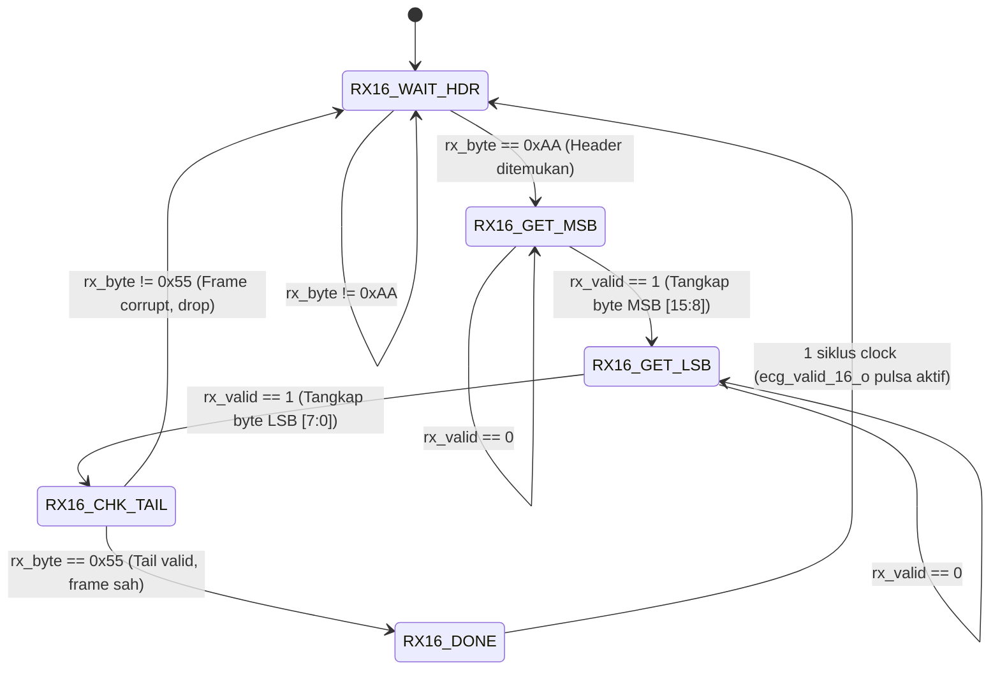
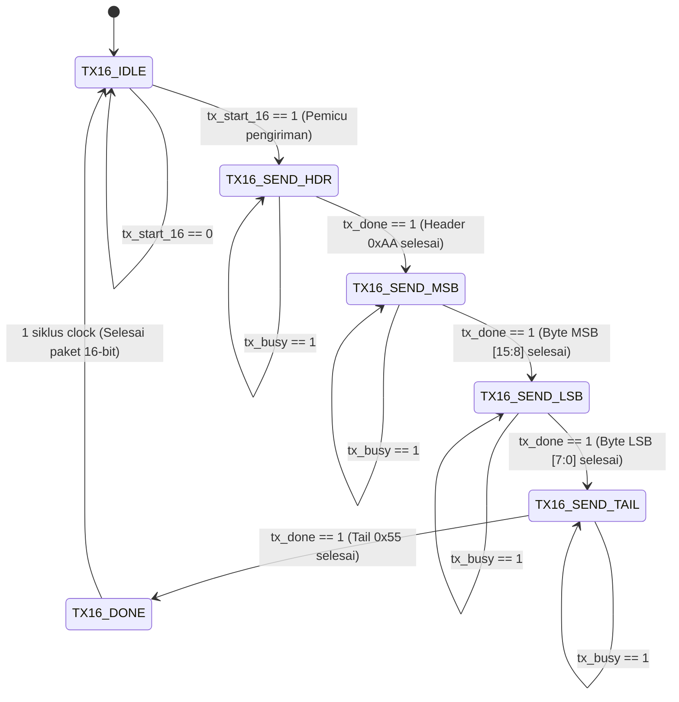

# RENCANA IMPLEMENTASI MODUL UART BIDIREKSIONAL 16-BIT (2-BYTE) (FPGA ↔ LAPTOP)
**Dokumen:** Rencana Implementasi & Arsitektur RTL UART 16-Bit / 2-Byte  
**Target:** FPGA Artix-7 (Nexys-4 / 100 MHz SysClk) & Laptop/PC Host / Generator EKG (Baud Rate 115.200 bps)  
**Tujuan Pembaruan:** Penyesuaian protokol komunikasi untuk menerima & mengirimkan data sampel EKG 16-bit (2-byte / format Q15 signed integer).  
**Kepatuhan Desain:** Standar FSM Moore 3-Always Block, Strict Output Port (`output wire` + internal `reg` + `assign`), Divider-Free, Anti-Metastabilitas.

---

## 1. Latar Belakang & Spesifikasi Data 16-Bit (2-Byte)

Generator sinyal EKG (baik dari script laptop, web serial dashboard di `ui/monitor.html`, maupun instrumen eksternal) mengirimkan data amplitudo EKG dengan resolusi **16-bit (2 byte, format signed integer / fixed-point Q15)**:
* **Resolusi Sampel EKG:** 16-bit (`[15:0]` = `ecg_sample_16`).
* **Kebutuhan Serial:** Karena jalur fisik UART mentransmisikan data per-byte (8-bit), data 16-bit harus dibagi menjadi **2 byte serial**:
  * **Byte 1 (MSB):** `ecg_sample_16[15:8]`
  * **Byte 2 (LSB):** `ecg_sample_16[7:0]`
* **Kompatibilitas Protokol:**
  1. **Mode A - Raw 2-Byte Stream:** Pengiriman berurutan MSB lalu LSB (cocok untuk throughput maksimum & latensi terendah).
  2. **Mode B - Framed Packet 4-Byte (Sinkron dengan `ui/monitor.html`):**
     $$\text{Paket TX Host} = [\text{0xAA}] \; [\text{ECG\_MSB}] \; [\text{ECG\_LSB}] \; [\text{0x55}]$$
     * Header `0xAA` dan Delimiter `0x55` menjamin deteksi batas frame (*frame boundary lock*) sehingga desinkronisasi/byte-drop tidak akan merusak integritas data 16-bit.

---

## 2. Hirarki & Struktur Modul di dalam `top_uart.v`

Seluruh modul akan disatukan di bawah satu modul tingkat atas **`top_uart.v`**, memisahkan layer physical serial (8-bit) dan layer packet assembler/serializer (16-bit).

```
┌───────────────────────────────────────────────────────────────────────────────────────┐
│                                     top_uart.v                                        │
│                                                                                       │
│   clk, rst_n, uart_rx_i                                                   uart_tx_o   │
│   ───────────┬─────────                                                   ▲           │
│              │                                                            │           │
│              ▼                                                            │           │
│     ┌─────────────────┐                                                   │           │
│     │   uart_sync.v   │                                                   │           │
│     │ (2-Stage DFF)   │                                                   │           │
│     └────────┬────────┘                                                   │           │
│              │ rx_sync_w                                                  │           │
│              ▼                                                            │           │
│     ┌─────────────────┐                                          ┌─────────────────┐  │
│     │   uart_rx.v     │                                          │   uart_tx.v     │  │
│     │  (8-bit Moore)  │                                          │  (8-bit Moore)  │  │
│     └────────┬────────┘                                          └────────▲────────┘  │
│              │ rx_data [7:0]                                              │ tx_data   │
│              │ rx_valid (pulsa 1-clk)                                     │ tx_start  │
│              ▼                                                            │           │
│     ┌─────────────────┐                                          ┌────────┴────────┐  │
│     │ uart_rx_16bit.v │                                          │ uart_tx_16bit.v │  │
│     │ (FSM Moore:     │                                          │ (FSM Moore:     │  │
│     │  2-Byte Assembler)                                         │  2-Byte Serial) │  │
│     └────────┬────────┘                                          └────────▲────────┘  │
│              │                                                            │           │
│              │ ecg_sample_16_o [15:0]                                     │ tx_16_i   │
│              │ ecg_valid_16_o (pulsa 1-clk)                               │ tx_16_strt│
│              ▼                                                            │           │
│     ┌─────────────────────────────────────────────────────────────────────┴─────┐     │
│     │                   Logika Loopback Echo 16-Bit / Multiplexer               │     │
│     │   (Jika loopback_en=1: memantulkan 16-bit kembali ke laptop otomatis)     │     │
│     └───────────────────────────────────┬───────────────────────────────────────┘     │
│                                         │                                             │
│       Antarmuka Paralel 16-bit ke Akselerator EKG FPGA (Filter -> QRS -> ANN)         │
│       [ ecg_data_16_o [15:0], ecg_valid_16_o, app_tx_data_16_i, app_tx_start_16_i ]  │
└─────────────────────────────────────────┼─────────────────────────────────────────────┘
                                          ▼
                         Pipeline Ekstraksi Fitur & ANN
```

### Rencana Pembagian Modul:
1. **`uart_sync.v`**: Double-stage DFF untuk input serial `uart_rx_i`.
2. **`uart_rx.v`**: Modul penerima fisik 8-bit UART (FSM Moore, mid-bit sampling).
3. **`uart_tx.v`**: Modul pengirim fisik 8-bit UART (FSM Moore, pembentuk frame 10-bit).
4. **`uart_rx_16bit.v`**: FSM Moore Assembler yang merakit 2 byte serial (MSB & LSB) beserta validasi framing header `0xAA` / tail `0x55` menjadi data 16-bit utuh (`ecg_data_16_o`).
5. **`uart_tx_16bit.v`**: FSM Moore Serializer yang memecah data 16-bit (`tx_data_16_i`) menjadi 2 byte serial (atau 4 byte berbingkai `0xAA`...`0x55`) untuk dikirimkan melalui `uart_tx.v`.
6. **`top_uart.v`**: Mengintegrasikan kelima modul di atas, menyediakan sakelar `loopback_en_i`, dan mengekspos bus paralel 16-bit ke modul internal (Bandpass Filter & ANN).
7. **`tb_top_uart.v`**: Testbench untuk memverifikasi pertukaran kata 16-bit (2-byte) dari laptop ke FPGA dan sebaliknya.

---

## 3. Desain FSM Moore 16-Bit RX Assembler (`uart_rx_16bit.v`)

Modul ini bertanggung jawab mengumpulkan aliran byte dari `uart_rx.v` dan menguncinya menjadi kata 16-bit yang valid.

### A. State Diagram FSM Moore RX 16-Bit (Framed Mode)



> **Catatan Dukungan Raw 2-Byte:** Jika mode konfigurasi RAW aktif (`FRAME_MODE = 0`), FSM beroperasi dengan 3 state: `RX16_GET_MSB` $\to$ `RX16_GET_LSB` $\to$ `RX16_DONE`.

### B. Tabel Transisi State & Output Moore RX 16-Bit

| State | Encoding | Fungsi Hardware | Logika Transisi Berikutnya ($NS$) | Output Terdaftar ($PS$) |
|---|---|---|---|---|
| `RX16_WAIT_HDR` | `3'b000` | Menunggu byte pembuka `0xAA` | Jika `rx_valid && (rx_data == 0xAA)` $\to$ `RX16_GET_MSB` | `valid_16_reg = 0` |
| `RX16_GET_MSB` | `3'b001` | Menangkap 8-bit MSB ke buffer `msb_reg` | Jika `rx_valid` $\to$ `RX16_GET_LSB` | `valid_16_reg = 0` |
| `RX16_GET_LSB` | `3'b010` | Menangkap 8-bit LSB ke buffer `lsb_reg` | Jika `rx_valid` $\to$ `RX16_CHK_TAIL` | `valid_16_reg = 0` |
| `RX16_CHK_TAIL` | `3'b011` | Memeriksa apakah tail adalah `0x55` | Jika `rx_valid && (rx_data == 0x55)` $\to$ `RX16_DONE`, else $\to$ `RX16_WAIT_HDR` | `valid_16_reg = 0` |
| `RX16_DONE` | `3'b100` | Menghasilkan data 16-bit sah `{msb_reg, lsb_reg}` | Kembali ke `RX16_WAIT_HDR` pada siklus berikutnya | `valid_16_reg = 1`, `ecg_data_16_reg = {msb, lsb}` |

---

## 4. Desain FSM Moore 16-Bit TX Serializer (`uart_tx_16bit.v`)

Modul ini menerima input 16-bit (`tx_data_16_i`) dan pulsa pemicu `tx_start_16_i`, lalu secara otomatis mengoordinasikan pengiriman serial berurutan ke `uart_tx.v`.

### A. State Diagram FSM Moore TX 16-Bit (Framed Mode)



### B. Tabel Transisi State & Output Moore TX 16-Bit

| State | Encoding | Data yang Dikirim ke `uart_tx` | Logika Transisi Berikutnya ($NS$) | Output Kendali Terdaftar |
|---|---|---|---|---|
| `TX16_IDLE` | `3'b000` | Tidak ada | Jika `tx_start_16 == 1` $\to$ `TX16_SEND_HDR` | `tx_busy_16_reg = 0`, `tx_done_16_reg = 0` |
| `TX16_SEND_HDR` | `3'b001` | `8'hAA` | Jika transmisi selesai (`tx_done`) $\to$ `TX16_SEND_MSB` | `tx_busy_16_reg = 1`, pemicu `byte_start` |
| `TX16_SEND_MSB` | `3'b010` | `tx_buf_16[15:8]` | Jika transmisi selesai (`tx_done`) $\to$ `TX16_SEND_LSB` | `tx_busy_16_reg = 1`, pemicu `byte_start` |
| `TX16_SEND_LSB` | `3'b011` | `tx_buf_16[7:0]` | Jika transmisi selesai (`tx_done`) $\to$ `TX16_SEND_TAIL` | `tx_busy_16_reg = 1`, pemicu `byte_start` |
| `TX16_SEND_TAIL`| `3'b100` | `8'h55` | Jika transmisi selesai (`tx_done`) $\to$ `TX16_DONE` | `tx_busy_16_reg = 1`, pemicu `byte_start` |
| `TX16_DONE` | `3'b101` | Tidak ada | Transisi kembali ke `TX16_IDLE` | `tx_busy_16_reg = 0`, `tx_done_16_reg = 1` |

---

## 5. Rencana Port Baru Modul `top_uart.v` (Berbasis 16-Bit)

Modul `top_uart.v` akan diperbarui untuk menyediakan port paralel 16-bit:

```verilog
module top_uart #(
    parameter integer CLK_FREQ   = 100_000_000,
    parameter integer BAUD_RATE  = 115_200,
    parameter [0:0]   FRAME_MODE = 1'b1          // 1: Framed [0xAA, MSB, LSB, 0x55], 0: Raw 2-Byte [MSB, LSB]
)(
    input  wire        clk,
    input  wire        rst_n,

    // Serial Pins
    input  wire        uart_rx_i,
    output wire        uart_tx_o,

    // Konfigurasi Mode Uji Loopback (Echo 16-Bit)
    input  wire        loopback_en_i,

    // Antarmuka Data EKG 16-Bit (Langsung ke Filter Digital & Detektor QRS)
    output wire [15:0] ecg_sample_16_o,   // Sampel EKG 16-bit (Q15 signed integer)
    output wire        ecg_sample_valid_o, // Pulsa 1 siklus saat sampel 16-bit valid

    // Antarmuka Transmisi 16-Bit (Untuk Telemetri / Data Balasan ke Laptop)
    input  wire [15:0] app_tx_data_16_i,
    input  wire        app_tx_start_16_i,
    output wire        app_tx_busy_16_o,
    output wire        app_tx_done_16_o,

    // Indikator Board Nexys-4
    output wire [7:0]  led_byte_o,
    output wire        led_sample_tick_o
);
```

---

## 6. Rencana Verifikasi Testbench (`tb_top_uart.v`)

Testbench akan diperbarui untuk memverifikasi pertukaran kata 16-bit secara presisi:
1. **Task Host PC Kirim 16-Bit:**
   * Mengirimkan paket frame: `[0xAA]` $\to$ `sample[15:8]` $\to$ `sample[7:0]` $\to$ `[0x55]` dengan baud rate 115.200 bps.
2. **Task Host PC Terima 16-Bit:**
   * Menerima dan memverifikasi 4 byte frame dari FPGA, lalu merekonstruksi data 16-bit.
3. **Kasus Uji Sampel EKG:**
   * Sampel Positif: `+1250` (`16'h04E2` $\approx$ puncak gelombang R).
   * Sampel Negatif: `-350` (`16'hFEA2` $\approx$ lembah gelombang Q/S).
   * Pola Batas: `16'h7FFF` (Maksimum Q15), `16'h8000` (Minimum Q15), dan `16'h0000` (Baseline isoelektrik).
4. **Verifikasi Loopback 16-Bit & Application Mode:**
   * Memastikan data yang dikirim oleh Laptop dipantulkan kembali secara utuh tanpa pemotongan byte atau pergeseran MSB/LSB.

---

## 7. Rangkuman Langkah Eksekusi Berikutnya (Setelah Persetujuan)
1. Membuat modul [`uart_rx_16bit.v`](file:///home/nexus_is/5.Project/Hackaton_ICDeC/rtl/Verilog/uart_rx_16bit.v) (FSM Moore 2-Byte Assembler).
2. Membuat modul [`uart_tx_16bit.v`](file:///home/nexus_is/5.Project/Hackaton_ICDeC/rtl/Verilog/uart_tx_16bit.v) (FSM Moore 2-Byte Serializer).
3. Memperbarui [`top_uart.v`](file:///home/nexus_is/5.Project/Hackaton_ICDeC/rtl/Verilog/top_uart.v) untuk menghubungkan adaptor 16-bit ke physical layer 8-bit UART.
4. Memperbarui [`tb_top_uart.v`](file:///home/nexus_is/5.Project/Hackaton_ICDeC/rtl/Verilog/tb_top_uart.v) dan menjalankan verifikasi simulasi 16-bit.
